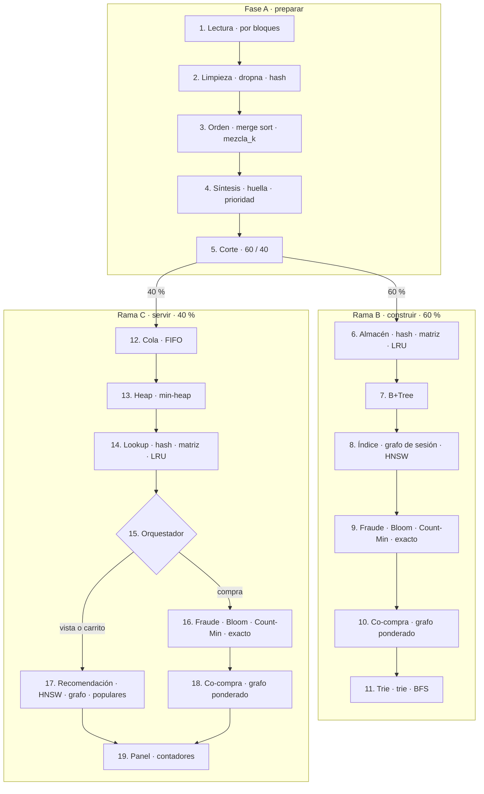

# Motor inteligente de comercio electrónico (REES46)

Trabajo del curso de Estructuras de Datos y Algoritmos. Toma eventos reales de una tienda multi-categoría (vistas, carritos y compras del dataset público REES46) y los recorre en tres tramos: preparar el lote, construir las estructuras con el 60 % y servir el 40 % restante.

El programa es un notebook de Jupyter. Se ejecutó en [Google Colab](https://colab.research.google.com/). El CSV de octubre de 2019 no está en este repositorio: el notebook lo descarga con `kagglehub` al correr.

## Qué hay en esta carpeta

```text
Comercio_Electronico_EDA_REES46/
├── README.md
├── Proyecto_EDA_Motor_Ecommerce_REES46_MODO_quick.ipynb   demo: 100.000 eventos
├── Proyecto_EDA_Motor_Ecommerce_REES46_MODO_FULL.ipynb    escala: hasta 10.000.000 + auditorías
└── Informe_EDA_REES46.docx                                informe escrito de la entrega
```

| Si se quiere… | Abrir |
|---|---|
| Ver el sistema y el dashboard en una corrida corta | `Proyecto_EDA_Motor_Ecommerce_REES46_MODO_quick.ipynb` |
| Medir escalas grandes y las auditorías v4–v7 | `Proyecto_EDA_Motor_Ecommerce_REES46_MODO_FULL.ipynb` |
| Leer el análisis, las decisiones y la evidencia | `Informe_EDA_REES46.docx` |

Los dos notebooks comparten el mismo pipeline. El modo `quick` ya viene fijado en el primero (`RUN_MODE = "quick"`). El segundo es la versión ampliada (v7) con `RUN_MODE = "full"`: el mismo recorrido de bloques, más persistencia del B+Tree, comparativas de LSH, HNSW y comunidades, benchmarks y un paquete de evidencias. No mezclar tablas de una corrida con las de la otra.

## Qué hace el pipeline

El informe usa este diagrama (canvas *Pipeline · bloques y algoritmos*). La numeración es la de Fases ABC: todo el lote pasa por la Fase A, el corte del bloque 5 abre la Rama B con el 60 % y la Rama C con el 40 %. Fraude y recomendación en la Rama C solo leen lo que armó la Rama B.



| Bloque | Algoritmos |
|---|---|
| 1. Lectura | Lectura por bloques |
| 2. Limpieza | dropna · fillna · tabla hash (`drop_duplicates`) |
| 3. Orden | Merge sort · mezcla_k (heap) |
| 4. Síntesis | Huella determinista · reglas de prioridad |
| 5. Corte | Corte por posición 60/40 |
| 6. Almacén | Hash (dict) · matriz dispersa · LRU |
| 7. B+Tree | B+Tree |
| 8. Índice | Grafo de sesión · HNSW (o KNN exacto) |
| 9. Fraude | Bloom Filter · Count-Min Sketch · conjunto exacto |
| 10. Co-compra | Grafo ponderado |
| 11. Trie | Trie · BFS |
| 12. Cola | Cola FIFO (deque) |
| 13. Heap | Min-heap |
| 14. Lookup | Hash · matriz dispersa · LRU · B+Tree si el producto es nuevo |
| 15. Orquestador | Bifurcación por tipo de evento |
| 16. Fraude | Bloom Filter · Count-Min Sketch · conjunto exacto |
| 17. Recomendación | HNSW · grafo de sesión · populares |
| 18. Co-compra | Grafo ponderado |
| 19. Panel | Contadores del stream |

Al terminar, el dashboard tiene seis pestañas: buscar producto, rango de precios, recomendar, simular un evento, panel de alertas y grafo de co-compra.

REES46 trae vistas, carritos y compras con marca, categoría, precio y sesión. El notebook completa, con semilla 42, el dispositivo, el medio de pago, el tipo de entrega y la etiqueta de fraude. Esos campos no vienen en el CSV. Solo se abre un mes, `2019-Oct.csv`. No se procesan los siete meses del dataset.

## Cómo ejecutarlo en Google Colab

La corrida de demostración es el notebook en modo `quick`.

1. Entra a [Google Colab](https://colab.research.google.com/).
2. **Archivo → Subir notebook** y elige `Proyecto_EDA_Motor_Ecommerce_REES46_MODO_quick.ipynb`.
   También se puede abrir desde GitHub si el repositorio es accesible: **Archivo → Abrir notebook → GitHub**.
3. Deja la primera celda de código como está: `RUN_MODE = "quick"`, `DATASET_FILE = "2019-Oct.csv"`, `SEED = 42`.
4. **Entorno de ejecución → Ejecutar todas**.
5. Cuando termine, baja hasta el dashboard.

Qué ocurre en esa corrida:

- Si falta `hnswlib`, el notebook intenta instalarlo. Si la instalación falla, el índice vectorial usa KNN exacto.
- `kagglehub` descarga el dataset público `mkechinov/ecommerce-behavior-data-from-multi-category-store` y localiza `2019-Oct.csv`. La descarga es el archivo del mes completo; el modo `quick` solo lee las primeras 100.000 filas.
- Si `kagglehub` no puede bajar el archivo, sube `2019-Oct.csv` al directorio de trabajo de la sesión de Colab (panel de archivos de la izquierda) y vuelve a ejecutar.

El dataset es público. No hace falta pegar tokens, claves ni `kaggle.json` dentro del notebook ni de este repositorio.

### Corrida full

Abre `Proyecto_EDA_Motor_Ecommerce_REES46_MODO_FULL.ipynb` del mismo modo y ejecuta todas las celdas de arriba hacia abajo. Ya trae `RUN_MODE = "full"` y `MAX_EVENTS = 10_000_000`.

Esa corrida lee hasta diez millones de eventos y mide 1K, 10K, 100K, 1M y 10M. En Colab puede tardar bastante, usar mucha RAM o cortarse si la sesión se desconecta. Una interrupción no significa que se hayan procesado diez millones de eventos: las escalas que sí se midieron quedan en `evidencias_eda_v7/inventario_v7.json`, que se puede descargar desde el panel de archivos al final.

En `full`, los tamaños de 1M y 10M usan 3 repeticiones en los benchmarks del núcleo. El resto de ese modo usa 100. El modo `quick` usa 7. El B+Tree indexa productos distintos, no diez millones de filas de eventos.

## Parámetros de la primera celda

| Parámetro | Quick | Full | Efecto |
|---|---|---|---|
| `RUN_MODE` | `"quick"` | `"full"` | Elige cuántos eventos se leen y qué escalas se miden |
| `DATASET_FILE` | `2019-Oct.csv` | igual | Único archivo mensual que se abre |
| `MAX_EVENTS` | `10_000_000` | igual | Tope de lectura cuando el modo es `full` |
| `SEED` | `42` | igual | Semilla de la huella sintética, NumPy y las comunidades |

En `quick` se leen 100.000 eventos y los benchmarks llegan hasta 100K. En `full` se lee hasta `MAX_EVENTS`.

## Informe

`Informe_EDA_REES46.docx` documenta el problema, el dataset, las estructuras elegidas y la evidencia de la ejecución. Las cifras del informe corresponden a la corrida que las generó; una nueva ejecución en Colab puede variar en tiempos, y el modo `quick` no cubre las escalas de 1M ni de 10M.
